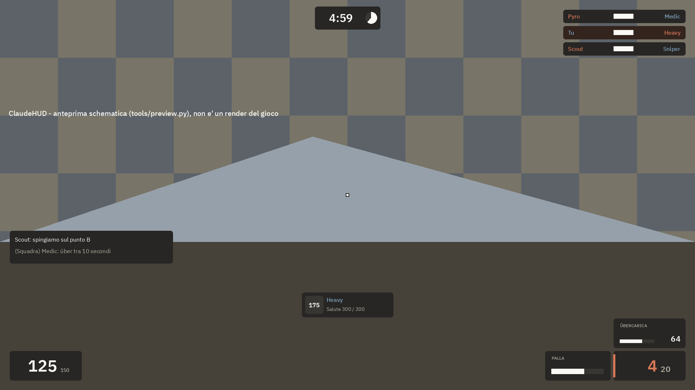
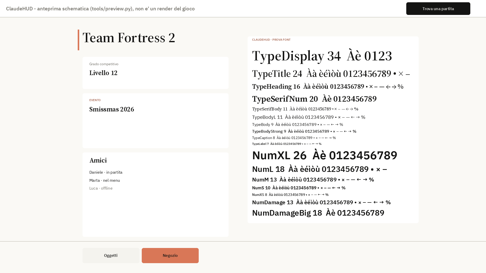

# ClaudeHUD

Una HUD per Team Fortress 2 che porta in gioco il linguaggio visivo di Claude: calma, calore, ordine
tipografico. In partita è un insieme di piccole schede scure e calde ai margini dello schermo; nei menu
diventa una pagina avorio con titoli serif. Le regole complete sono in [DESIGN.md](DESIGN.md).

> Progetto di fan, non affiliato ad Anthropic né a Valve. Non contiene loghi di Claude o di Anthropic.




*Le immagini sono **anteprime schematiche** generate da `tools/preview.py` con i font veri e la
geometria letta dai file `.res`. Non sono screenshot del gioco: raggi, hinting dei font e contenuti
reali saranno diversi.*

## Installazione

1. Scarica il repository (Code → Download ZIP) o clonalo.
2. Copia la cartella in `Steam/steamapps/common/Team Fortress 2/tf/custom/ClaudeHUD/`, in modo che
   `info.vdf`, `resource/` e `scripts/` siano direttamente dentro `ClaudeHUD/`.
   Le cartelle `#TF2 Files`, `#HL2 Files`, `#Platform Files`, `#Map Files`, `tools/`, `docs/` e
   `licenses/` non servono al gioco: puoi non copiarle. Restano nel repository come riferimento e
   come strumenti.
3. Avvia il gioco. Al primo avvio nel menu principale compare la **scheda di prova font** (a destra).

### Interruttori

| Cosa | Come |
|---|---|
| Spegnere la scheda di prova font | In `resource/ui/mainmenuoverride.res` togli la riga `#base "claudehud_fonttest.res"`. |
| Mirino ClaudeHUD (un punto avorio su un quadrato scuro) | In `scripts/hudlayout.res` metti `"visible" "1"` su `ClaudeXhairBack` e `ClaudeXhairDot`, poi in console `crosshair 0`. |

## Com'è fatto

- **Un'unica fonte di verità:** `tools/tokens.py` contiene la palette campionata dagli screenshot di
  riferimento, i colori derivati (con la formula), i ruoli, la scala tipografica e la griglia.
  `tools/build_scheme.py` genera `resource/clientscheme.res`, `sourcescheme.res` e `chatscheme.res`.
- **Font:** IBM Plex Sans (interfaccia e numeri di combattimento, a cifre tabulari) e Source Serif 4
  (titoli dei menu), TTF statici dalle release ufficiali, non modificati. Vedi [LICENSES.md](LICENSES.md).
- **Due modalità:** scura in partita e sulle superfici con gli oggetti del gioco, chiara nei menu dove
  si naviga e si legge (DESIGN.md §9).
- **Pannelli riscritti a mano** (61): salute, munizioni, classe, target ID, layout HUD, timer, KOTH,
  CTF, carrello, obiettivi e avvisi, scoreboard, selezione classe e squadra, menu principale, barra del
  matchmaking, carica Medic (con percentuale Über), metri degli oggetti, bombe adesive, cariche,
  travestimento, edifici e metallo dell'Engineer, numeri di danno e cura, selezione armi, attesa del
  respawn, killcam, fine round. Generatori in `tools/hand/`.
- **Verificato sul codice:** dove una proprietà del motore era incerta, l'ho controllata sul sorgente del
  client TF2 pubblicato da Valve nel 2025 (Source SDK 2013). Le verifiche sono in DESIGN.md e PROGRESS.md.
- **Tutti gli altri pannelli** (714) mantengono il layout di Valve ma ogni colore, font e bordo
  passa dai token (`tools/migrate.py`, che legge sempre gli originali intatti in `#TF2 Files`).
  La checklist file per file è in DESIGN.md §10.

## Strumenti

```bash
python3 tools/build.py
```

Ricostruisce tutto dagli originali e dai token, poi verifica (richiede `fonttools` e `pillow`). I singoli
controlli si possono lanciare anche da soli:

| Script | Cosa verifica |
|---|---|
| `tools/lint.py` | sintassi VDF, chiavi duplicate, colori/font/bordi definiti, nessun colore letterale non generato, proprietà e ControlName esistenti nei file Valve, elementi originali conservati |
| `tools/contrast.py` | tutti i contrasti dichiarati (WCAG), RED/BLU con daltonismo simulato |
| `tools/check_fonts.py` | font statici, nome famiglia interno, peso, cifre tabulari, glifi usati |
| `tools/layout_check.py` | layout a 4:3, 16:10, 16:9, 21:9: fuori schermo, sovrapposizioni, area centrale |
| `tools/coverage.py` | rigenera la checklist di copertura in DESIGN.md |
| `tools/preview.py` | rigenera le anteprime schematiche in `docs/` |

## Stato e test

Stato delle fasi, cose da verificare in gioco e problemi aperti: [PROGRESS.md](PROGRESS.md).
La HUD **non è ancora stata provata in gioco**.
